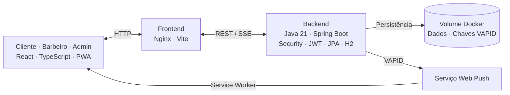

# Studio Soldado do Corte — Sistema Web de Agendamento

Projeto da disciplina **Desenvolvimento Web II** da **Universidade Estadual de Goiás (UEG)**, ministrada pelo professor **Braully Rocha da Silva**. Evolução da base da N1 para um sistema comercial completo de agendamento, gestão administrativa e programa de fidelidade para barbearias.

## Tecnologias

- **Backend:** Java 21, Spring Boot, Spring Security, JWT, Spring Data JPA, Bean Validation e H2 persistente.
- **Frontend:** React, TypeScript, React Router, Axios, Tailwind CSS e Vite.
- **Containerização:** Docker multi-stage (Maven/Temurin 21 + Node 22/Nginx unprivileged) e Docker Compose.

## Funcionalidades principais

- **Agendamento online e agenda da equipe:** escolha de serviço, profissional e horário disponível em tempo real, com bloqueios, expedientes e atualização instantânea via Server-Sent Events (SSE).
- **RBAC funcional por capacidades operacionais:** gestão de perfis e permissões com revogação imediata de sessão no backend (`DASHBOARD_ANALITICO`, `METAS_GERENCIAR`, `CLIENTES_GERENCIAR`, `AGENDAMENTOS_*`, `FIDELIDADE_ADMINISTRAR`, entre outras).
- **Painel gerencial (`/painel`) e desempenho (`/desempenho`):** indicadores financeiros com snapshot histórico de preço, ocupação real descontando bloqueios e sobreposições, ocupação na janela decorrida, rendimento por hora dos serviços (`valorPorHora`), mapa de demanda semanal e comparativos equivalentes de período.
- **Inteligência de negócio acionável e metas mensais:** motor determinístico em português com diagnósticos baseados exclusivamente nos dados reais, resumo executivo *Seu negócio neste período* e acompanhamento de metas mensais persistidas por mês no banco H2.
- **Retenção e fidelidade de clientes (`/clientes`):** classificação por comportamento de retorno (atrasado, esperado, agendamento futuro, recorrente, novo e histórico reduzido), intervalo mediano individual e cartão fidelidade com resgate de benefícios.
- **Personalização de marca e PWA/Web Push:** tema escuro editorial configurável no painel, logo oficial e notificações via SSE e Web Push (RFC 8291 / VAPID).

## Execução com Docker

```bash
docker compose up --build -d --wait
```

Após a inicialização dos containers, acesse: **http://localhost:8080**

O banco H2 e as chaves VAPID ficam persistidos no volume Docker `barbearia_dados`, preservando os registros entre reinicializações e recriações.

Para encerrar mantendo os dados persistidos:

```bash
docker compose down
```

### Modo produção (sem contas de demonstração)

1. Copie `.env.example` para `.env`.
2. Configure `SOLDADO_DEMO=false`, `SOLDADO_ADMIN_PASSWORD` e `SOLDADO_JWT_SECRET` (mínimo de 32 bytes).
3. Inicie com a sobreposição de produção:

```bash
docker compose -f compose.yaml -f compose.prod.yaml up --build -d --wait
```

## Execução local (sem Docker)

Com Java 21 e Node.js instalados:

```powershell
.\scripts\BUILD.cmd
.\scripts\INICIAR_SISTEMA.cmd
```

Acesse **http://localhost:8080** (ou pelo IP local da máquina no celular).

## Testes automatizados

```powershell
.\mvnw.cmd verify
```
## Arquitetura do Sistema


